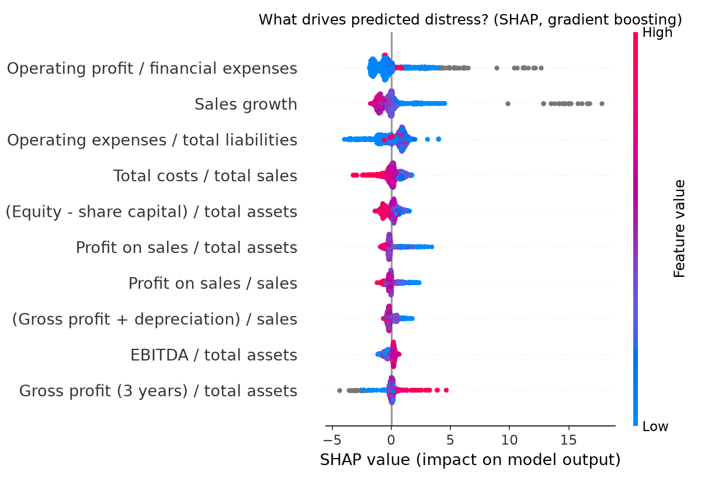

# Financial Distress Prediction with Machine Learning

**Author:** Dr Vikneswaran Manual, PhD (Finance)

Can machine learning flag a firm heading for bankruptcy a year ahead, better than the classic logistic-regression model used in finance research since Ohlson (1980)? This project compares three models on 64 financial ratios. It builds on the theme of my PhD research on corporate risk management, governance, capital structure and financial distress among Malaysian listed firms.

## Data
Polish Companies Bankruptcy dataset (Tomczak, 2016), UCI Machine Learning Repository (CC BY 4.0). Horizon used: one year ahead (`data/5year.arff`), 5,910 firm-years, 410 distressed (6.9%).

## Method
- Ratios winsorised at the 1st and 99th percentiles; missing values imputed with medians
- Class imbalance handled with balanced class weights
- Stratified 75/25 train-test split, seed 42
- Metrics: ROC-AUC, plus recall and precision on distressed firms

## Results (25% hold-out)

| Model | ROC-AUC | Recall (distressed) | Precision (distressed) |
|---|---|---|---|
| Logistic regression | 0.850 | 0.757 | 0.267 |
| Random forest | 0.926 | 0.233 | 0.558 |
| Gradient boosting | 0.958 | 0.631 | 0.802 |

Gradient boosting ranks firms best (AUC 0.958) and balances catching failures with few false alarms. Logistic regression catches more failing firms but raises many more false alarms; the random forest is the reverse at the default 0.5 cut-off, so a lower threshold would suit an early-warning use.

## Most informative ratios (random forest)
Profitability and cash-generation ratios dominate:
1. Profit on sales / total assets (Attr35)
2. Profit on sales / sales (Attr39)
3. Profit on operating activities / total assets (Attr22)
4. Sales growth, sales(n) / sales(n-1) (Attr21)
5. Profit on operating activities / financial expenses (Attr27)

## Early-warning extension (`early_warning.py`)
Three additions a credit analyst or regulator would ask for:

**1. Benchmark against Altman's Z'-score (private-firm version, 1983).** Machine learning ranks distressed firms far better than the traditional model.

**2. Early-warning threshold.** The default 0.5 cut-off misses about a third of failing firms. Tuning the cut-off on out-of-fold predictions to catch at least 80% of failures lifts recall to 86% on the hold-out set, at the cost of more false alarms, the right trade-off for an early-warning system.

| Model | ROC-AUC | Recall | Precision |
|---|---|---|---|
| Altman Z' (distress zone < 1.23) | 0.683 | 0.427 | 0.208 |
| Gradient boosting, cut-off 0.50 | 0.958 | 0.631 | 0.802 |
| Gradient boosting, early-warning cut-off | 0.958 | 0.864 | 0.454 |

5-fold stratified cross-validation AUC on the training set: 0.952.

**3. Explainability with SHAP.** Interest cover (operating profit / financial expenses) and sales growth are the strongest drivers: firms with weak interest cover and shrinking sales are pushed toward distress. This matches the finance literature on debt-servicing capacity and is what makes the model usable by a credit committee.



## Run it
```bash
pip install -r requirements.txt
python distress_model.py
python early_warning.py
```

## Next steps
- Apply the same pipeline to Bursa Malaysia listed firms with governance and ERM variables
- Compare against hazard (survival) models

## Reference
Tomczak, S. (2016). Polish Companies Bankruptcy [Dataset]. UCI Machine Learning Repository. https://doi.org/10.24432/C5F600
