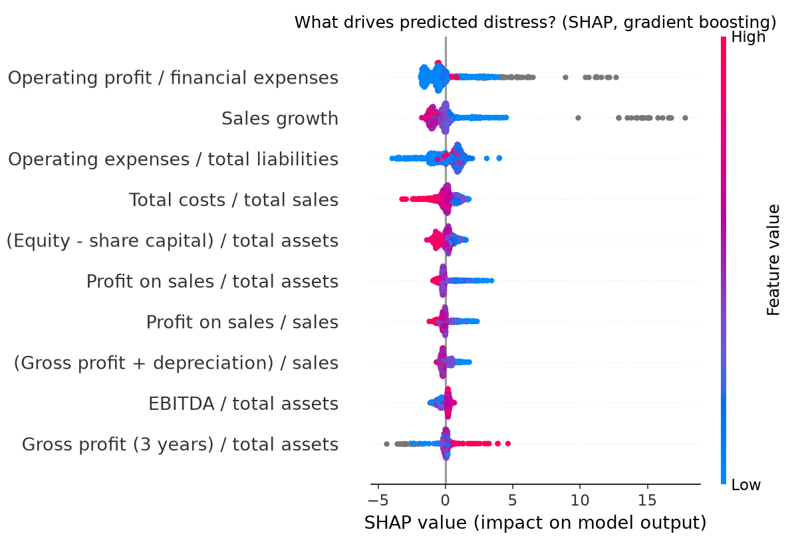

# Abstract

This paper asks whether machine-learning models predict corporate financial distress one year ahead more accurately than the accounting-ratio models that still dominate practice, and whether their predictions can be explained in terms a credit committee would accept. Using 5,910 firm-year observations and 64 financial ratios from the Polish Companies Bankruptcy dataset (Tomczak, 2016), I compare Altman's Z'-score, logistic regression, random forest and gradient boosting. Gradient boosting achieves a hold-out ROC-AUC of 0.958 (five-fold cross-validated AUC 0.952), against 0.850 for logistic regression and 0.683 for the Z'-score. Because the default 0.5 cut-off misses about a third of failing firms, I calibrate an early-warning threshold that lifts recall to 86.4% at a precision of 45.4%. SHAP values show that interest cover, sales growth and the ratio of operating expenses to total liabilities are the main drivers of predicted distress, consistent with the finance literature on debt-servicing capacity. The results support explainable machine learning as a practical early-warning tool for lenders, auditors and regulators.

**Keywords:** financial distress, bankruptcy prediction, machine learning, gradient boosting, Altman Z-score, SHAP, explainable AI

**JEL codes:** G33, G32, C53, C45

# 1. Introduction

Predicting which firms will fail is a long-standing problem in finance. Lenders price credit risk on it, auditors weigh it in going-concern opinions, and regulators use it to monitor systemic exposure. The field began with univariate ratio analysis (Beaver, 1966) and was shaped by Altman's (1968) multiple discriminant Z-score and Ohlson's (1980) logit model. These models remain widely used because they are transparent and easy to compute.

Machine-learning methods such as random forests (Breiman, 2001) and gradient boosting (Friedman, 2001) can capture non-linear relationships and interactions among ratios that linear models miss, and studies on bankruptcy data report large gains in accuracy (Zięba, Tomczak & Tomczak, 2016). Two concerns limit their adoption: they are often presented as black boxes, and they are usually judged at a default decision threshold that does not reflect the asymmetric cost of missing a failing firm.

This paper addresses both concerns. It makes three contributions:

1. It benchmarks machine learning directly against the Altman Z'-score on the same firms and the same hold-out sample.
2. It reframes the classification threshold as an early-warning design choice, tuned to catch at least 80% of failures.
3. It explains the model with SHAP values (Lundberg & Lee, 2017), linking each driver back to established financial theory.

# 2. Literature Review

**Accounting-ratio models.** Beaver (1966) showed that individual ratios, especially cash flow to total debt, differ between failed and surviving firms up to five years before failure. Altman (1968) combined five ratios into a discriminant score, later re-estimated as the Z'-score for private firms using book rather than market equity (Altman, 1983). Ohlson (1980) introduced logistic regression, which yields probabilities and avoids the distributional assumptions of discriminant analysis.

**Machine learning.** Ensemble tree methods can model threshold effects, for example interest cover that is harmless above a level and dangerous below it, without the analyst specifying them. Zięba et al. (2016), who introduced the dataset used here, found that boosted trees outperform discriminant, logit and neural-network benchmarks.

**Explainability.** Credit decisions must be justified to borrowers, boards and supervisors. SHAP (Lundberg & Lee, 2017) attributes each prediction to the input features in a way that is consistent and additive, making tree ensembles auditable at the level of an individual firm.

**Gap.** Many machine-learning studies report accuracy at a single default threshold and stop at feature-importance rankings. Fewer compare against the Z-score practitioners actually use, design the threshold around the cost of missed failures, and interpret drivers through finance theory. This paper does all three.

# 3. Data and Variables

The data are the Polish Companies Bankruptcy dataset (Tomczak, 2016), drawn from the Emerging Markets Information Service. Bankrupt firms were observed between 2000 and 2012 and surviving firms between 2007 and 2013. I use the one-year-ahead horizon: ratios from the fifth year of the forecasting period, with bankruptcy status one year later. The sample has 5,910 firm-years, of which 410 (6.9%) are distressed.

Each observation has 64 financial ratios covering profitability, liquidity, leverage, activity and size. Ratios are winsorised at the 1st and 99th percentiles to limit the influence of extreme values, and missing values are imputed with training medians where a model requires it.

# 4. Methodology

**Altman Z'-score.** For private firms, Altman (1983) defines

Z' = 0.717 X1 + 0.847 X2 + 3.107 X3 + 0.420 X4 + 0.998 X5

where X1 is working capital / total assets, X2 retained earnings / total assets, X3 EBIT / total assets, X4 book equity / total liabilities and X5 sales / total assets. Firms with Z' below 1.23 fall in the distress zone.

**Machine-learning models.** I estimate (i) logistic regression with robust scaling, (ii) a random forest of 400 trees and (iii) histogram-based gradient boosting with 400 iterations and a learning rate of 0.05. All use balanced class weights to address the 6.9% distress rate.

**Validation.** The sample is split 75/25 into training and hold-out sets, stratified by outcome (random seed 42). Gradient boosting is also assessed with five-fold stratified cross-validation on the training set.

**Early-warning threshold.** Using out-of-fold predictions on the training set, I select the highest probability cut-off at which recall on distressed firms is at least 80%, then apply it unchanged to the hold-out set.

**Explainability.** SHAP values are computed with TreeExplainer on 800 randomly drawn hold-out firms.

**Metrics.** ROC-AUC measures ranking ability independent of threshold. Recall (the share of distressed firms caught) and precision (the share of flagged firms that are truly distressed) measure decision quality.

# 5. Results

## 5.1 Model comparison

| Model | ROC-AUC | Recall (distressed) | Precision (distressed) |
|---|---|---|---|
| Altman Z' (distress zone < 1.23) | 0.683 | 0.427 | 0.208 |
| Logistic regression | 0.850 | 0.757 | 0.267 |
| Random forest | 0.926 | 0.233 | 0.558 |
| Gradient boosting (cut-off 0.50) | 0.958 | 0.631 | 0.802 |
| Gradient boosting (early-warning cut-off) | 0.958 | 0.864 | 0.454 |

*Table 1. Hold-out results (25% of the sample). Five-fold cross-validated AUC for gradient boosting on the training set is 0.952.*

The Z'-score ranks firms only moderately well (AUC 0.683) and catches fewer than half of failing firms. Logistic regression improves ranking substantially (AUC 0.850) but flags many healthy firms. Gradient boosting dominates on ranking (AUC 0.958), and the close agreement between its hold-out and cross-validated AUC indicates that the result is not an artefact of one split. The random forest ranks well but, at the default cut-off, is too conservative to serve as a warning system.

## 5.2 Early-warning threshold

At the default 0.5 cut-off, gradient boosting misses 37% of failing firms. Moving to the early-warning cut-off chosen on training folds raises recall to 86.4% on the hold-out set. Precision falls to 45.4%, meaning roughly one in two flagged firms goes on to fail, still more than twice the precision of the Z'-score. For a lender, reviewing two flagged firms to find one genuine failure is a reasonable cost; missing the failure is not.

## 5.3 What drives predicted distress

| Rank | Ratio | Mean SHAP |
|---|---|---|
| 1 | Operating profit / financial expenses (interest cover) | 1.220 |
| 2 | Sales growth, sales(t) / sales(t-1) | 1.080 |
| 3 | Operating expenses / total liabilities | 0.913 |
| 4 | Total costs / total sales | 0.476 |
| 5 | (Equity - share capital) / total assets | 0.416 |
| 6 | Profit on sales / total assets | 0.378 |
| 7 | Profit on sales / sales | 0.317 |
| 8 | (Gross profit + depreciation) / sales | 0.316 |
| 9 | EBITDA / total assets | 0.297 |
| 10 | Gross profit (3 years) / total assets | 0.289 |

*Table 2. Top ten drivers by mean absolute SHAP value (800 hold-out firms).*

{ width=85% }

Low interest cover is the strongest signal of distress, consistent with the view that failure is ultimately an inability to service debt. Falling sales push firms toward distress, echoing the role of shrinking scale and operating leverage. Accumulated reserves relative to assets, a proxy for past profitability like Altman's retained-earnings ratio, are protective. Several profitability ratios appear in the top ten, confirming that the model rediscovers the economics behind traditional models while weighting them non-linearly.

# 6. Discussion and Implications

**For lenders and auditors.** An explainable gradient-boosting model can flag at-risk borrowers earlier and more reliably than the Z'-score, and SHAP lets an analyst state why a particular firm was flagged.

**For regulators.** Threshold design should be explicit. Reporting accuracy at a 0.5 cut-off hides the trade-off that matters most in supervision: the number of failures missed.

**For research.** The findings support combining machine learning with theory-driven interpretation rather than treating the two as rivals.

# 7. Limitations and Further Research

The data cover Polish firms from 2000 to 2013, so the specific coefficients and thresholds may not transfer to other markets or periods. The Z'-score is applied with its published coefficients rather than re-estimated, which is how practitioners use it but may understate its potential. The split is random rather than strictly time-ordered.

Further work will apply the same pipeline to firms listed on Bursa Malaysia, adding enterprise risk management and corporate-governance variables from my doctoral research, use time-ordered validation, and compare against hazard (survival) models.

**Data and code availability.** All results are reproducible with `distress_model.py` and `early_warning.py` in the accompanying repository.

# References

Altman, E. I. (1968). Financial ratios, discriminant analysis and the prediction of corporate bankruptcy. *The Journal of Finance, 23*(4), 589–609.

Altman, E. I. (1983). *Corporate financial distress: A complete guide to predicting, avoiding, and dealing with bankruptcy.* Wiley.

Beaver, W. H. (1966). Financial ratios as predictors of failure. *Journal of Accounting Research, 4*, 71–111.

Breiman, L. (2001). Random forests. *Machine Learning, 45*(1), 5–32.

Friedman, J. H. (2001). Greedy function approximation: A gradient boosting machine. *The Annals of Statistics, 29*(5), 1189–1232.

Lundberg, S. M., & Lee, S.-I. (2017). A unified approach to interpreting model predictions. *Advances in Neural Information Processing Systems, 30*.

Ohlson, J. A. (1980). Financial ratios and the probabilistic prediction of bankruptcy. *Journal of Accounting Research, 18*(1), 109–131.

Tomczak, S. (2016). *Polish Companies Bankruptcy* [Dataset]. UCI Machine Learning Repository. https://doi.org/10.24432/C5F600

Zięba, M., Tomczak, S. K., & Tomczak, J. M. (2016). Ensemble boosted trees with synthetic features generation in application to bankruptcy prediction. *Expert Systems with Applications, 58*, 93–101.

